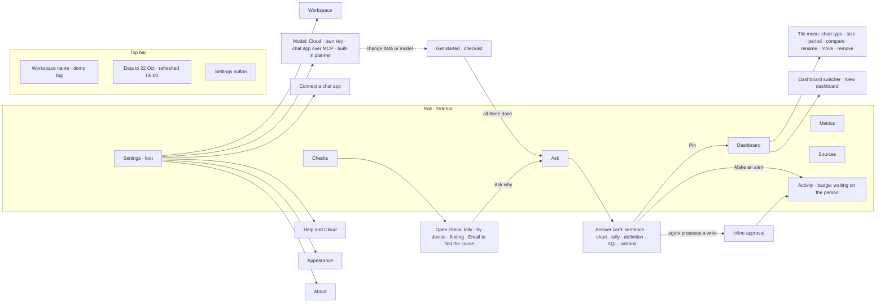
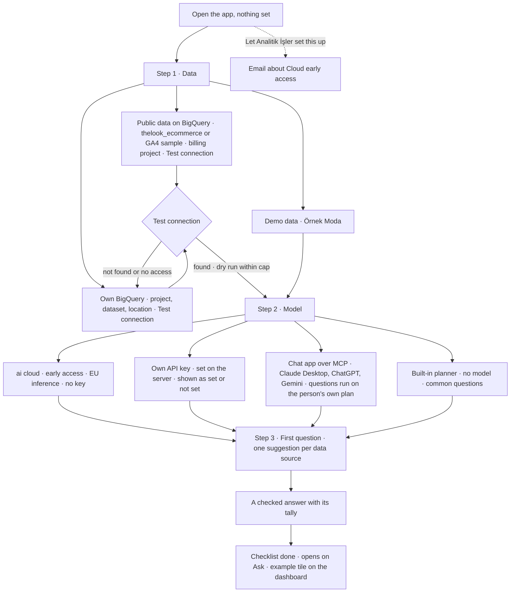

# Flows · ai analyst redesign (23 Oct 2026)

Read with `design/ux-audit.md` and the mockups in `design/mockups/` (open `index.html`). Component names in brackets are the shadcn vocabulary the build will use, themed with the design-system tokens (`web/vendor/tokens.css`): sharp corners, navy grounds, Google Sans, the tally.

## 1. Information architecture

Primary sections (Ask, Dashboard, Checks) sit first in the rail; Metrics and Sources below a rule; Activity carries the badge; Settings is the rail foot. Alerts is no longer a section: alerts are rows in Activity and decisions are made there or inline in the thread.

On phones (below 768) the rail becomes a bottom tab bar [Tabs] with Ask, Dashboard, Checks and More; More opens a [Sheet] with Metrics, Sources, Activity and Settings. The top bar is one row.

## 2. First run

Rules:
- Progress is visible ("1 of 3 done") and each step can be reopened from Settings later (data source and model both link back to the step).
- Nothing in the checklist asks for a credential in the browser. BigQuery uses the Google credentials on the machine running ai analyst; the form says so and "Test connection" reports what it found (dataset, table, dry-run bytes, the bytes cap). An API key is set on the server and shown only as "set" or "not set".
- Public data needs the person's own Google Cloud project for billing; the mockup says it fits the monthly free query allowance and that the bytes cap (2 GB by default) protects them.
- The GA4 sample (`bigquery-public-data.ga4_obfuscated_sample_ecommerce`) has no order source, so the checks cannot run; the option says "GA4 metrics only · no check" so nobody expects a tally.
- With MCP as the model route, the first question is asked in the chat app, not here; step 3 shows the question to paste and finishes when the server logs its first `run_query` from that client.
- When all three are done the checklist disappears; the app opens on Ask, the example answer becomes a dashboard tile marked "Example".

## 3. Decisions, and where they depart from the proposed direction

| Decision | Why |
|---|---|
| Alerts merged into Activity, with the badge counting only what waits on the person. | Alerts were one list of pending and active rows; a decision is an activity, and the badge "1 ?" beside "Alerts" plus "1 needs approval" in the rail foot counted the same thing twice. As proposed. |
| Rail keeps icons from the sprite (the app's own `i-agents`, `i-dashboards`, `i-audit`, `i-measurement`, `i-warehouse`, `i-analysis`) with a word beside each. | The earlier spec wanted no icons in the rail because the sprite lacked some; the current build added them and they help on the phone tab bar. Icons never stand alone. |
| Agent steps collapse to one line "Checked 2 sources · 3 steps" and open on click; while running the line reads "Working · step 2 of about 3" and the last step says "working". | Owner feedback. Collapsible tool steps map to the shadcn AI "tool" component. |
| Approvals are inline in the thread and repeated in Activity › Waiting. Deciding in either place updates both. | The spec's inline approval; Activity is the log, not the only place. |
| The "Make an alert" button opens a small [Dialog] prefilled from the card instead of creating at once. | A write with a schedule and a recipient should be read before it exists. Same shape as the agent's proposal, so the two feel like one thing. |
| Dashboard tiles have three sizes (small, wide, full width), six chart types (line, area, bar, stacked bar, table, figure with tally), a per-tile period and "compare with the previous period", rename, move, remove; more than one dashboard. Every option is also an agent action and the menu says so ("Or ask: make this a wide bar chart"). | Owner feedback. The agent and the menu call the same action (`update_tile`), logged and undoable like every write. |
| The orange mark: one per section. In the thread it is the open answer's Δ; on the dashboard it is the one headline tile (set in the tile menu); on Checks it is the open check's Δ. Tiles and list rows use `data-mark="none"`. | Design-system rule. |
| The worked example is a dashboard tile marked "Example · from the demo question", removable like any tile, and the demo workspace says so in the top bar tag. | Keeps the one answer the owner wants people to see without faking a conversation. |
| Departure: no docked agent panel on Dashboard and Checks in this round. Instead each of those pages has one "Ask about this" action that opens Ask with the page as context, and the tile menu and check actions name the agent phrasing. | The docked panel from the earlier spec is good but doubles the surface to design and build; the owner's first complaint was confusion. Add it after the single-surface version is clear. |
| Departure: Settings › Model shows the MCP route as one of four equal choices, and "Connect a chat app" is a separate section with the per-app snippet. | A person on a Claude or ChatGPT plan reads "use it from the app I already pay for" at the Model step; the snippet is a setup detail they need once. No "sign in with your subscription" option is designed, since no honest route exists for it. |
| Departure: the top bar does not show which model answers. | It was there three times. The answer card's footer says "Answered by the built-in planner" once when no model is set, because that changes what the answer can do; otherwise nothing. |
| Theme in Settings is System / Dark / Light; the mockups also keep a theme button in the top bar for review only (labelled as a mockup control). | Owner wants one Settings page; the review needs a quick switch. |
| Phone: bottom tab bar with four items instead of the spec's menu dialog. | Four words fit 320 px in Turkish (Sor · Pano · Kontroller · Diğer); seven did not, which is why the spec chose a dialog. |

Not designed here, listed for the build: thread list (more than one conversation), metric detail pages, source cards (Sources keeps the current rows), the period picker's calendar, drag to reorder (menu commands are the keyboard path and ship first).

## 4. String table · the new screens

TR is impersonal (no "siz", no "-niz"), headings are noun phrases without a full stop, buttons take the UI imperative, verdicts are lowercase, nothing is uppercase, tool names stay English.

| # | Where | EN | TR |
|---|---|---|---|
| 1 | Rail | Ask | Sor |
| 2 | Rail | Dashboard | Pano |
| 3 | Rail | Checks | Kontroller |
| 4 | Rail | Metrics | Metrikler |
| 5 | Rail | Sources | Kaynaklar |
| 6 | Rail | Activity | İşlem geçmişi |
| 7 | Rail foot, top bar | Settings | Ayarlar |
| 8 | Phone tab bar | More | Diğer |
| 9 | Top bar | Data to 22 Oct 2026 · refreshed 06:00 | Veri 22 Eki 2026’ya kadar · 06:00’da yenilendi |
| 10 | Top bar tag | demo data | demo veri |
| 11 | Get started | Get started | Başlangıç |
| 12 | Get started | 1 of 3 done | 3 adımdan 1’i tamam |
| 13 | Step 1 | Data | Veri |
| 14 | Step 1 option | Demo data · Örnek Moda, an invented shop | Demo veri · Örnek Moda, uydurma bir mağaza |
| 15 | Step 1 option | Public data on BigQuery | BigQuery’de açık veri |
| 16 | Step 1 option | The company’s own BigQuery | Şirketin BigQuery projesi |
| 17 | Step 1 note | GA4 metrics only · no order source to check against | Yalnızca GA4 metrikleri · karşılaştırılacak sipariş kaynağı yok |
| 18 | Step 1 note | Needs a Google Cloud project of the company’s own for billing. The queries fit the free monthly allowance; the bytes cap (2 GB) protects it. | Faturalama için şirketin kendi Google Cloud projesi gerekir. Sorgular aylık ücretsiz kotaya sığar; bayt sınırı (2 GB) korur. |
| 19 | Step 1 button | Test connection | Bağlantıyı test et |
| 20 | Step 1 result | Connected · daily_channel_device · 90 days · dry run 12 MB | Bağlandı · daily_channel_device · 90 gün · deneme çalıştırma 12 MB |
| 21 | Step 1 error | Dataset not found. Check the project and dataset names. Nothing was changed. | Veri kümesi bulunamadı. Proje ve veri kümesi adları kontrol edilmeli. Hiçbir şey değiştirilmedi. |
| 22 | Step 2 | Model | Model |
| 23 | Step 2 option | ai cloud · early access · EU inference · no key | ai cloud · erken erişim · AB’de çalışır · anahtar gerekmez |
| 24 | Step 2 option | The company’s own API key · Anthropic now, OpenAI and Gemini later | Şirketin API anahtarı · şimdilik Anthropic, sonra OpenAI ve Gemini |
| 25 | Step 2 option | From a chat app over MCP · Claude Desktop, ChatGPT, Gemini · questions run on the person’s own plan | Sohbet uygulamasından, MCP ile · Claude Desktop, ChatGPT, Gemini · sorular kişinin kendi planında çalışır |
| 26 | Step 2 option | Built-in planner · no model · common questions | Yerleşik planlayıcı · model yok · sık sorulan sorular |
| 27 | Step 2 status | set / not set | ayarlı / ayarlı değil |
| 28 | Step 3 | First question | İlk soru |
| 29 | Step 3 button | Ask it | Sor |
| 30 | Done | Set up. The example answer is on the dashboard. | Kurulum tamam. Örnek yanıt panoda. |
| 31 | Cloud card | Let Analitik İşler set this up | Kurulumu Analitik İşler yapsın |
| 32 | Ask empty | Questions about the shop’s data | Mağaza verisi üzerine sorular |
| 33 | Ask empty | Every answer comes with its query, its definition and a check against the source. | Her yanıt sorgusu, tanımı ve kaynakla karşılaştırmasıyla gelir. |
| 34 | Composer | Ask about orders, revenue or the checks | Sipariş, ciro ya da kontroller hakkında sor |
| 35 | Composer | Ask / Stop | Sor / Durdur |
| 36 | Steps line | Checked 2 sources · 3 steps | 2 kaynak kontrol edildi · 3 adım |
| 37 | Steps, running | Working · step 2 | Çalışıyor · 2. adım |
| 38 | Verdicts | adds up / does not add up / not sure / not checked | tutuyor / tutmuyor / emin değil / kontrol edilmedi |
| 39 | Tally | Difference · tolerance ±5% | Fark · tolerans ±%5 |
| 40 | Card actions | Pin to dashboard · Make an alert · Copy SQL | Panoya sabitle · Alarm kur · SQL’i kopyala |
| 41 | Approval | Needs approval · Approve · Edit first · Decline · Can be undone. | Onay gerekiyor · Onayla · Önce düzenle · Reddet · Geri alınabilir. |
| 42 | Tile menu | Chart type: line · area · bar · stacked bar · table · figure | Grafik türü: çizgi · alan · çubuk · yığılmış çubuk · tablo · tek rakam |
| 43 | Tile menu | Size: small · wide · full width | Boyut: küçük · geniş · tam genişlik |
| 44 | Tile menu | Period · Compare with the previous period · Rename · Move up · Move down · Remove | Dönem · Önceki dönemle karşılaştır · Yeniden adlandır · Yukarı taşı · Aşağı taşı · Kaldır |
| 45 | Tile menu foot | Or ask: “make this a wide bar chart” | Ya da sorulur: “bunu geniş çubuk grafik yap” |
| 46 | Dashboard | Example · from the demo question | Örnek · demo sorudan |
| 47 | Dashboard | New dashboard | Yeni pano |
| 48 | Checks | Out of tolerance since 9 Oct · release v4.12 | 9 Eki’den beri tolerans dışında · v4.12 sürümü |
| 49 | Checks | Email to find the cause | Nedeni bulmak için e-posta yaz |
| 50 | Activity | Waiting for a decision · Agent · People · System | Karar bekleyen · Ajan · Kişiler · Sistem |
| 51 | Settings | Workspace · Model · Connect a chat app · Help and Cloud · Appearance · About | Çalışma alanı · Model · Sohbet uygulaması bağla · Yardım ve Cloud · Görünüm · Hakkında |
| 52 | Settings | Interface language · Theme · System · Dark · Light | Arayüz dili · Tema · Sistem · Koyu · Açık |
| 53 | Settings | The “find the cause” email goes to: Analitik İşler · own team · off | “Nedeni bul” e-postası: Analitik İşler · şirketin ekibi · kapalı |
| 54 | Settings | A self-hosted copy sends nothing to Analitik İşler. | Şirketin kendi sunucusundaki kopya Analitik İşler’e hiçbir şey göndermez. |
